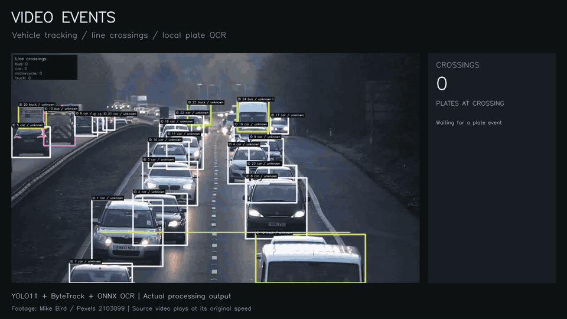

# Video Events

[](https://github.com/sonxlover-copi/video-events/actions/workflows/checks.yml)


Подсчёт транспорта, трекинг и чтение номеров на видео с одной неподвижной камеры. Программа работает локально и сохраняет размеченное видео, события пересечения линии и каталог треков.

[](https://raw.githubusercontent.com/sonxlover-copi/video-events/main/docs/assets/showcase/option-a.mp4)

**[Смотреть MP4 · 12 секунд](https://raw.githubusercontent.com/sonxlover-copi/video-events/main/docs/assets/showcase/option-a.mp4)** · [CSV событий](docs/assets/showcase/option-a-events.csv) · [Другой фрагмент и воспроизведение](docs/showcase.md)

На этом фрагменте программа зарегистрировала **10 пересечений**, у **4 событий** есть подтверждённый текст номера. Примеры `MW51VSU`, `GX15OGJ`, `WR02FKD` и `EY61NBG` сверены с исходными кадрами. Панель справа показывает только события, уже подтверждённые к текущему кадру. Это демонстрация работы, а не независимая оценка точности OCR.

Видео: [Mike Bird / Pexels](https://www.pexels.com/video/traffic-flow-in-the-highway-2103099/), [Pexels License](https://www.pexels.com/license/). Разметка и панель событий построены Video Events.

**Стек:** Python 3.12 · YOLO11 · ByteTrack · OpenCV · ONNX Runtime · CLI.

Вход — видео и YAML с линией и классами. Выход — MP4, CSV событий и JSON со сводкой запуска. Поддерживаются классы COCO `car`, `motorcycle`, `bus` и `truck`. Дополнительные режимы определяют видимый цвет кузова и читают номер с подтверждением по нескольким кадрам.

[Установка](#установка) · [Запуск](#запуск) · [Цвет и номера](#цвет-автомобиля-и-номер) · [Результаты](#проверенные-результаты) · [Правило пересечения](docs/demo.md)

## Возможности

- Проверка метаданных видео и декодирования первого кадра.
- Подсчёт пересечений конечного отрезка с deadband для снижения дрожания рамок.
- Запись времени пересечения, кадра подтверждения, track ID, класса, направления и координат.
- Локальный CLI без сервера и внешнего API.
- Сравнение событий с траекториями UA-DETRAC по классу, направлению, времени и координатам.
- Оценка цвета кузова и накопление наблюдений внутри ID трекера.
- Локальный детектор номеров и OCR, проверка формата и повторных чтений.
- Каталог `vehicles.csv` с признаками всех треков, включая машины без пересечения линии.
- Чтение номеров на отдельной фотографии командой `read-plates`.

Ограничения: обработка только заранее записанного видео с одной камерой; нет RTSP, скорости в км/ч или межкамерного трекинга. Качество зависит от сцены, перекрытий и стабильности треков. Цвет оценивается эвристикой по изображению кузова; номера требуют достаточного размера и читаемости.

## Установка

Нужны Python 3.12, [`uv`](https://docs.astral.sh/uv/), FFmpeg и совместимый с PyTorch драйвер NVIDIA для GPU-режима. На Ubuntu FFmpeg можно установить так:

```bash
sudo apt install ffmpeg
```

Затем из каталога проекта:

```bash
uv sync --locked
mkdir -p models
```

Помести совместимые веса YOLO11 по адресу `models/yolo11n.pt`. Весовой файл не хранится в Git. Перед коммерческим развёртыванием проверь условия лицензий Ultralytics, весов и набора данных.

## Запуск

Проверить видео:

```bash
uv run video-events inspect --input /path/to/traffic.mp4
```

Посчитать пересечения:

```bash
uv run video-events count \
  --input /path/to/traffic.mp4 \
  --config configs/traffic.yaml \
  --output-dir runs/traffic-demo
```

Результаты сохраняются в указанную папку:

- `annotated.mp4` — H.264-видео с рамками, ID треков, линией и счётчиками;
- `events.csv` — одна строка на зарегистрированное пересечение;
- `summary.json` — конфигурация и сводка обработки.

В `configs/traffic.yaml` линия задана нормализованными координатами от 0 до 1. Направления `negative_to_positive` и `positive_to_negative` задаются ориентацией линии `start → end`; сопоставь их с «въездом» и «выездом» под конкретную камеру. Для настройки линии используй копию YAML и сначала просматривай размеченное видео.

По умолчанию устройство выбирается автоматически: CUDA, если она доступна в PyTorch, иначе CPU. Можно задать `device: cpu` или `device: "0"` в конфиге.

## Цвет автомобиля и номер

Цвет включается флагом `--colors` и работает с обычной установкой. Для номеров сначала установи дополнительную группу и один раз подготовь модели:

```bash
uv sync --locked --extra plates
uv run --extra plates video-events prepare-plates
```

После подготовки обработка выполняется локально. Запуск обоих режимов:

```bash
uv run --extra plates video-events count \
  --input /path/to/traffic.mp4 \
  --config configs/traffic.yaml \
  --output-dir runs/traffic-attributes \
  --colors --plates
```

В видео появятся цвет и подтверждённый номер рядом с ID. В `events.csv` добавятся признаки, известные на момент пересечения. Отдельный `vehicles.csv` содержит итоговые признаки каждого ID за весь клип, а `summary.json` — распределение цветов, число подтверждённых номеров и сведения о моделях.

По умолчанию признаки обновляются раз в 10 кадров для каждого трека. Для подтверждения номера нужны минимум два одинаковых чтения с OCR confidence не ниже 0.85 и долей совпадений не ниже 60%. Эти пороги фильтруют кандидатов, но не гарантируют правильное чтение. Для стандартного российского автомобильного номера добавь `--plate-format ru`: проверяется форма `А123ВС77` или `А123ВС777`, без угадывания замен `О/0`.

Чтение фотографии:

```bash
uv run --extra plates video-events read-plates \
  --input /path/to/car.jpg --output-dir runs/plate-photo
```

Результат — `plates.jpg` и `plates.json`. Чтение с одной фотографии отмечается как кандидат, без подтверждения по времени.

[Настройки, поля CSV и ограничения](docs/attributes.md) · [проверка новых режимов](reports/attributes_validation.md).

## Проверенные результаты

Настройки линии и порогов проверялись на двух клипах train-части UA-DETRAC с похожей геометрией дороги. Фургоны из XML сопоставлялись с `car`, поскольку у модели COCO нет отдельного класса `van`.

| Клип | Эталон | Предсказано | TP / FP / FN | Precision | Recall | F1 | Ошибка количества |
| --- | ---: | ---: | --- | ---: | ---: | ---: | ---: |
| MVI_40201 | 103 | 89 | 87 / 2 / 16 | 0.978 | 0.845 | 0.906 | −14 (−13,6%) |
| MVI_40204 | 134 | 117 | 116 / 1 / 18 | 0.991 | 0.866 | 0.924 | −17 (−12,7%) |

Ошибка количества — предсказанное число минус эталонное. Высокий precision означает мало лишних событий, но не исключает недосчёт: recall и ошибка количества показывают пропуски. Подробности расчёта и измерения скорости — в [итоговом отчёте](reports/results.md).

На MVI_40204 одно автобусное пересечение на выбранной линии совпало с XML. На MVI_40141 мотоцикл и его пересечение проверены визуально; XML этого клипа не размечает мотоциклы, поэтому количественной метрики для класса нет. Подробности, параметры сопоставления и ограничения — в [отчёте оценки](reports/ua_detrac_mvi40201_baseline.md).

Это результаты разработки на родственных сценах, а не независимая оценка на другой камере и не гарантия точности на видео заказчика. До коммерческого обещания метрик нужна отдельная размеченная выборка из целевой среды.

## Повторить оценку на UA-DETRAC

Локально должны быть подготовлены видео, XML-разметка и результат `count`. Пример для MVI_40201:

```bash
uv run python scripts/evaluate_detrac.py \
  --video data/processed/ua_detrac/MVI_40201.mp4 \
  --config configs/ua_detrac_mvi40201_line_y054_lowconf.yaml \
  --annotations data/raw/ua_detrac/selected/DETRAC-Train-Annotations-XML/MVI_40201.xml \
  --events data/processed/ua_detrac/MVI_40201_line_y054_lowconf_run/events.csv \
  --tolerance-s 1 \
  --spatial-tolerance-px 40 \
  --class-alias van=car \
  --report reports/ua_detrac_mvi40201_lowconf.json
```

Оценщик выводит event precision/recall при сопоставлении один к одному. Временной допуск и пространственный порог — параметры диагностики; фиксируй их до финальной оценки. Отложи для финального отчёта другие исходные последовательности, не использованные для выбора линии и параметров.

## Обучение классификатора транспорта

Добавлен отдельный эксперимент на XML-разметке UA-DETRAC: скрипт проверяет боксы, делит данные по целым видео, собирает кропы `car`/`bus`/`van` и обучает компактную CNN на PyTorch с аугментациями torchvision. Для подготовки и обучения нужны локальные архивы датасета:

```bash
uv run python scripts/train_vehicle_classifier.py prepare
uv run python scripts/train_vehicle_classifier.py train --epochs 12
```

В Git находятся код и агрегированный [отчёт обучения](reports/vehicle_classifier_2026-11-10.json); изображения, подготовленный массив кропов и checkpoint остаются локально. Это демонстрация обучения классификатора готовых объектов, а не переобучение основного YOLO-детектора. [Описание процесса, проверки разметки и ограничений](docs/training.md).

Запуск на 12 отложенных видеопоследовательностях UA-DETRAC Train показал accuracy `0.826` и macro F1 `0.807`. Для `van` F1 составил `0.665`, поэтому эксперимент также показывает текущую ошибку классификации, а не только итоговую сводную метрику.

## Проверки кода

Из корня репозитория:

```bash
uv run python -m unittest discover -s tests -v
uv run ruff check src scripts tests
uv run ruff format --check src scripts tests
```

Тесты проверяют геометрию, deadband, интерполяцию времени, независимость треков, сопоставление событий, метрики, цвет, нормализацию и подтверждение номеров. Они не требуют весов или датасета и не измеряют качество нейросетей. GitHub Actions запускает два задания: основные проверки в dev-окружении и все проверки с NumPy/OpenCV. PyTorch и OCR-модели в CI не загружаются.

## Структура

```text
configs/       рабочие YAML и готовые сцены-примеры
docs/          постановка задачи и ограничения
reports/       итоговый разбор и агрегаты оценки
scripts/       оценка, подготовка данных и обучение классификатора
src/           CLI, чтение конфигурации и подсчёт пересечений
tests/         проверки геометрии, сопоставления событий и метрик
data/          локальные исходные и обработанные данные (не входят в Git)
models/        локальные веса (не входят в Git)
runs/          результаты пользовательских запусков (не входят в Git)
```

См. [спецификацию MVP](docs/project_spec.md) для логики подсчёта, технической приёмки и критериев коммерческой оценки, [памятку по локальным данным](docs/data.md) для структуры и подготовки UA-DETRAC и [черновик кейса для портфолио](docs/portfolio_case_study.md).
