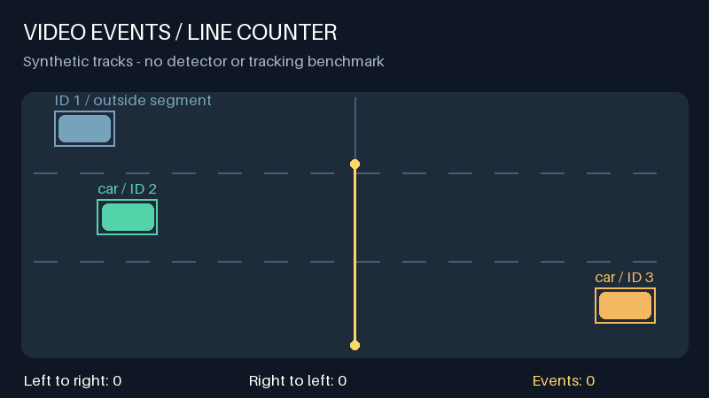

# Демонстрация счётчика



Эта анимация построена на трёх заданных траекториях. События вычисляются настоящим `LineCrossingCounter`; детектор и трекер в этом примере не запускаются. Это позволяет показать правило пересечения без распространения кадров стороннего датасета.

Из корня проекта после `uv sync --locked`:

```bash
uv run python scripts/build_counter_demo.py
```

Команда создаёт `docs/assets/counter-demo.gif`, статичный кадр `counter-demo.png` и полный `events.csv`. В CSV два события: по одному в каждом направлении. Траектория выше отрезка события не создаёт. Confidence равен `1.0` как входное значение синтетического примера; это не оценка уверенности нейросети.

Для результата на реальном видео используй команду `count` из README. Она сохраняет рамки YOLO, ID ByteTrack и события счётчика в `annotated.mp4`, `events.csv` и `summary.json`. Подготовленные локальные результаты UA-DETRAC остаются в `data/processed/ua_detrac/`; короткий фрагмент для просмотра можно получить так:

```bash
mkdir -p runs/demo
ffmpeg -ss 4 -i data/processed/ua_detrac/MVI_40204_line_y054_lowconf_run/annotated.mp4 \
  -t 12 -an -c:v libx264 -crf 23 -pix_fmt yuv420p -movflags +faststart \
  runs/demo/traffic-preview.mp4
```

Каталог `runs/` исключён из Git. Условия публикации кадров исходного видео проверяются отдельно; ссылка на источник и описание локальных данных — в [памятке](data.md).
