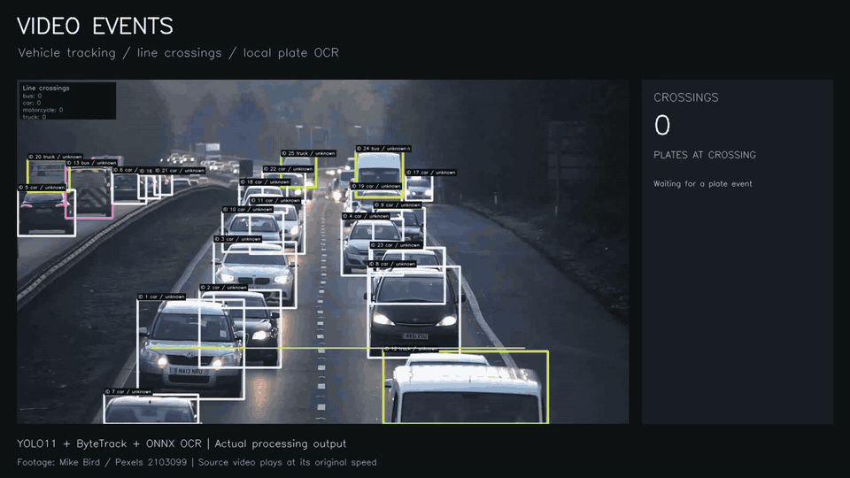
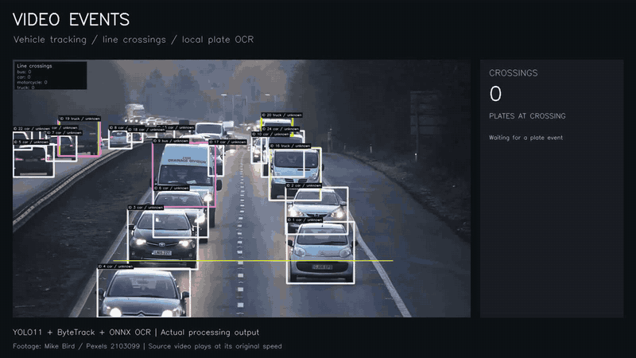

# Демонстрации на реальном движении

Оба фрагмента получены собственным запуском Video Events на видео [Traffic Flow In The Highway](https://www.pexels.com/video/traffic-flow-in-the-highway-2103099/) автора Mike Bird. Исходное видео доступно по [Pexels License](https://www.pexels.com/license/); в репозитории размещены короткие производные ролики с нашей разметкой и панелью событий.

## Вариант 1 — выбран для главной страницы

[](https://raw.githubusercontent.com/sonxlover-copi/video-events/main/docs/assets/showcase/option-a.mp4)

[Открыть MP4, 12 с](https://raw.githubusercontent.com/sonxlover-copi/video-events/main/docs/assets/showcase/option-a.mp4) · [CSV событий](assets/showcase/option-a-events.csv)

Первые 12 секунд исходной записи. Программа зарегистрировала 10 пересечений, у четырёх событий есть подтверждённый номер. Тексты `MW51VSU`, `GX15OGJ`, `WR02FKD`, `EY61NBG` сверены с соответствующими исходными кадрами.

## Вариант 2 — более длинный фрагмент

[](https://raw.githubusercontent.com/sonxlover-copi/video-events/main/docs/assets/showcase/option-b.mp4)

[Открыть MP4, 16 с](https://raw.githubusercontent.com/sonxlover-copi/video-events/main/docs/assets/showcase/option-b.mp4) · [CSV событий](assets/showcase/option-b-events.csv)

Участок исходной записи с 26-й секунды. Программа зарегистрировала 15 пересечений, у пяти событий есть подтверждённый номер. Отдельно сверены примеры `GJ06EPD`, `LN15ZZC`, `DA07CLX` и `EY09VWS`.

## Что показывает панель

Число пересечений и список номеров строятся из `events.csv` по `confirmation_frame_index`. Событие появляется на панели только после подтверждения в исходном запуске. Итоговые номера из конца клипа не переносятся в его начало. Подтверждение означает согласованность нескольких чтений OCR; оно не исключает повторяющуюся ошибку модели.

Видеоролики воспроизводятся с исходной скоростью движения. Это офлайн-обработка, а не заявление о работе в реальном времени. Превью GIF имеет 6 кадров/с в первом варианте и 4 во втором, MP4 — 15 кадров/с. Разрешение презентации 1600×900; анализ выполнялся на 1920×1080 с входом детектора 960. Цвет на этой сумеречной сцене может ошибаться из-за освещения; главные примеры здесь — трекинг, события и номера.

Выборочно сверенные номера не заменяют полной разметки и количественной оценки OCR. В полных запусках встречаются спорные и короткие кандидаты. Данные о параметрах, итогах полных 18-секундных запусков, версиях моделей и проверенных примерах записаны в [протоколе](../reports/showcase_2026-11-09.json).

## Повторить результат

Нужны обычные веса YOLO11n и подготовленные модели номеров, как описано в [инструкции](attributes.md). Скачай исходный файл с указанной страницы Pexels и сохрани как `data/samples/pexels-2103099-4k.mp4`.

Подготовить первый фрагмент и выполнить анализ из корня репозитория:

```bash
ffmpeg -i data/samples/pexels-2103099-4k.mp4 -t 18 \
  -vf 'scale=1920:1080,fps=15' -an -c:v libx264 -crf 18 \
  data/samples/pexels-2103099-a.mp4

uv run --extra plates video-events count \
  --input data/samples/pexels-2103099-a.mp4 \
  --config configs/pexels_2103099_showcase.yaml \
  --output-dir runs/my-showcase-a --colors --plates --attribute-interval 5

uv run --extra plates python scripts/build_showcase.py \
  --run-dir runs/my-showcase-a --output runs/my-showcase-a.mp4 --duration-s 12
```

Для второго фрагмента добавь `-ss 26` перед `-i` при подготовке видео, выбери другие входные/выходные пути и укажи `--duration-s 16` при оформлении. Веса, полный исходник и промежуточные результаты не входят в Git.
